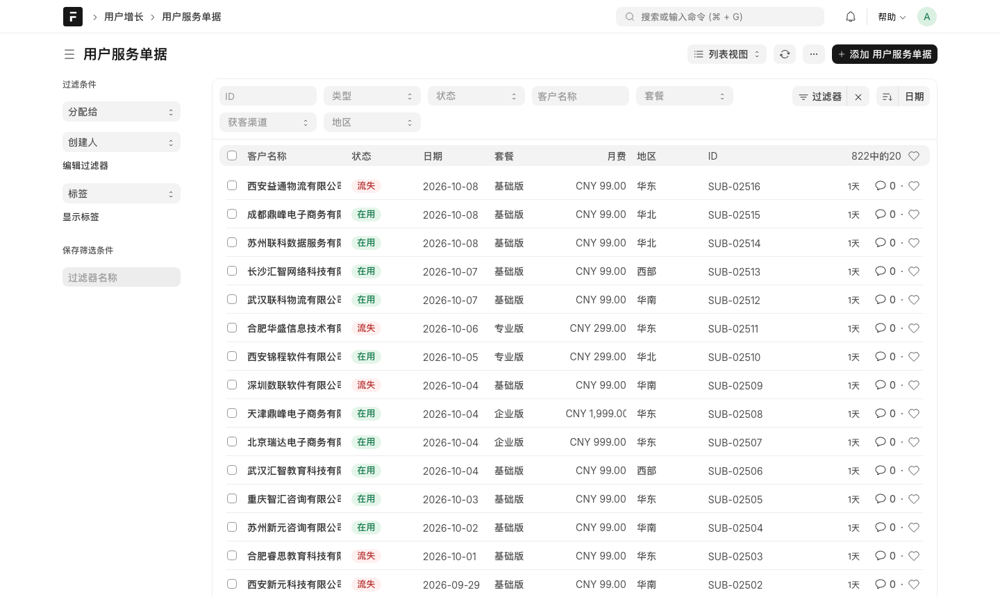
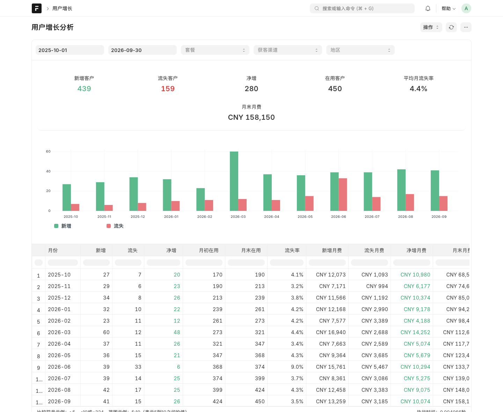

## User Growth

基于 Frappe v15 的用户增长分析 App：记录用户服务的开通 / 流失，提供增长报表和数据大屏。


### 安装

环境：Frappe v15，MariaDB 10.6+，Python 3.11。

```bash
cd $PATH_TO_YOUR_BENCH
bench get-app $URL_OF_THIS_REPO --branch develop
bench --site $SITE install-app user_growth
```

安装时会自动生成约 21 个月的演示数据（截止到安装当天）。

### 功能

**用户服务单据**（工作区：用户增长 → 用户服务单据）

- 每条单据记录一次开通或流失；流失单必须关联一条在用的开通单，客户信息自动带出
- 流失单提交后，对应开通单状态自动变为「已流失」



**用户增长分析**（报表）

- 按月统计新增、流失、净增、在用客户、流失率和月费（MRR）
- 可按日期、套餐、渠道、地区筛选，支持导出



**用户增长大屏**（页面）

- 核心指标环比、增长趋势、套餐 / 渠道 / 地区 / 流失原因分布、最近动态
- 点击套餐、渠道、地区联动筛选整页；点击指标卡片或流失原因跳转到对应明细
- 深色 / 浅色主题切换，每 5 分钟自动刷新，支持全屏

### License

MIT
